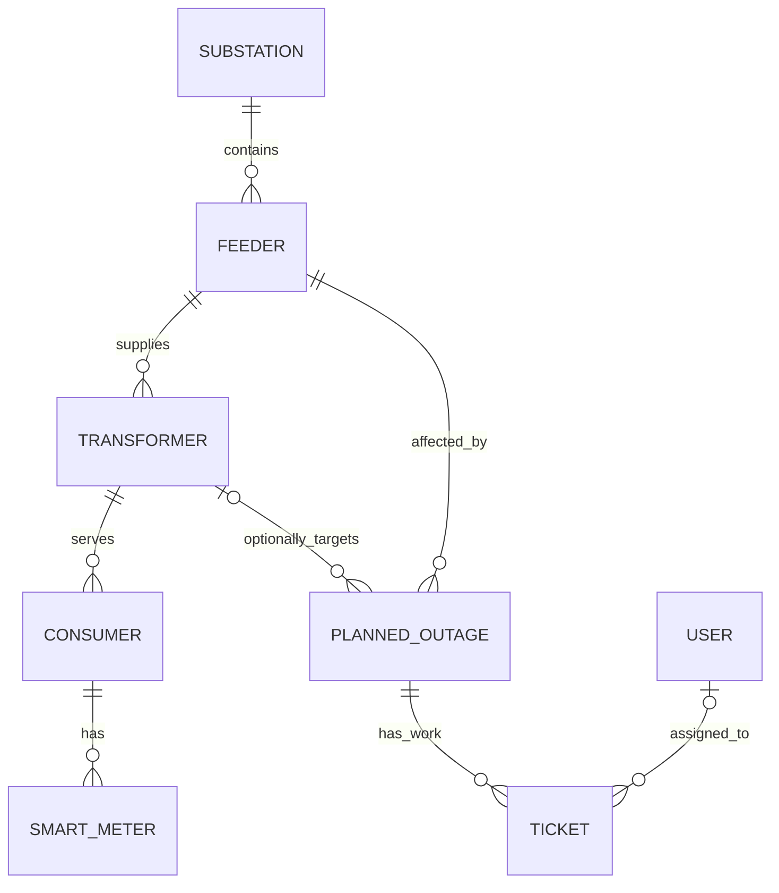

# Database Schema — Smart Grid OMS

The application uses MongoDB through Mongoose. The models below are based on the model files in `server/models/`. Mongoose automatically adds `_id`, `createdAt`, and `updatedAt` unless configured otherwise.

## Entity relationship overview

Relationships represent stored ObjectId references. The model definitions do not by themselves enforce cascading deletes.

## Collections and fields

### `users` — `User`

| Field | Type | Rules / meaning |
|---|---|---|
| `name` | String | Required; trimmed |
| `email` | String | Required, unique, lowercase, trimmed |
| `password` | String | Required; application stores a password hash |
| `role` | String | Required; `Administrator`, `Operator`, or `Field Engineer` |

### `substations` — `Substation`

| Field | Type | Rules / meaning |
|---|---|---|
| `name` | String | Required; trimmed |
| `code` | String | Required, unique, trimmed |
| `location.latitude` | Number | Required |
| `location.longitude` | Number | Required |

### `feeders` — `Feeder`

| Field | Type | Rules / meaning |
|---|---|---|
| `name` | String | Required; trimmed |
| `code` | String | Required, unique, trimmed |
| `substation` | ObjectId → `Substation` | Required |

### `transformers` — `Transformer`

| Field | Type | Rules / meaning |
|---|---|---|
| `name` | String | Required; trimmed |
| `code` | String | Required, unique, trimmed |
| `feeder` | ObjectId → `Feeder` | Required |
| `location.latitude` | Number | Required |
| `location.longitude` | Number | Required |

### `consumers` — `Consumer`

| Field | Type | Rules / meaning |
|---|---|---|
| `name` | String | Required; trimmed |
| `consumerNumber` | String | Required, unique, trimmed |
| `transformer` | ObjectId → `Transformer` | Required |
| `location.latitude` | Number | Required |
| `location.longitude` | Number | Required |

### `smartmeters` — `SmartMeter`

| Field | Type | Rules / meaning |
|---|---|---|
| `meterNumber` | String | Required, unique, trimmed |
| `consumer` | ObjectId → `Consumer` | Required |
| `status` | String | `Online`, `Offline`, or `Warning`; default `Online` |
| `voltage` | Number | Default `230` |
| `current` | Number | Default `0` |
| `power` | Number | Default `0` |
| `lastReading` | Date | Default current time |

These are stored readings/status fields; they do not establish a physical telemetry connection.

### `plannedoutages` — `PlannedOutage`

| Field | Type | Rules / meaning |
|---|---|---|
| `title` | String | Required; trimmed |
| `description` | String | Optional; trimmed |
| `feeder` | ObjectId → `Feeder` | Required |
| `transformer` | ObjectId → `Transformer` | Optional |
| `startTime` | Date | Required |
| `endTime` | Date | Required |
| `status` | String | `Scheduled`, `In Progress`, or `Restored`; default `Scheduled` |

### `tickets` — `Ticket`

| Field | Type | Rules / meaning |
|---|---|---|
| `outage` | ObjectId → `PlannedOutage` | Required |
| `fieldEngineer` | ObjectId → `User` | Optional |
| `description` | String | Required; trimmed |
| `status` | String | Required; default `Open`; no enum is defined in the schema |

## Data integrity notes

- `email`, asset `code` values, `consumerNumber`, and `meterNumber` have uniqueness constraints where shown.
- Most asset models use ObjectId references to represent the network hierarchy.
- `Ticket.status` is a required string but the schema does not define a fixed enum; clients should use the statuses supported by the UI/workflow.
- The models use timestamps.
- The schema files do not define geospatial indexes; map rendering uses latitude/longitude fields.
- Deleting a referenced record does not automatically cascade through related collections in the model definitions.
