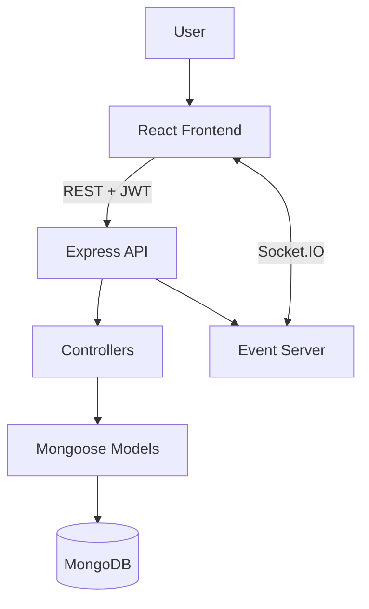

# Smart Grid Outage Management System (OMS)
## Final Internship Project Report

**Organization:** EficAa  
**Project:** Design and Development of a GIS-Based Smart Grid Outage Management System for Planned Outage Monitoring and Reliability Analysis  
**Technology:** React, Leaflet, Node.js, Express, MongoDB, JWT, Socket.IO  
**Prepared by:** Gautami Chagantipati  
**Document status:** Draft for mentor review — confirm any required institutional template and internship dates before submission.

## Abstract

This project implements a web-based Outage Management System (OMS) for organizing planned distribution outages and supporting operational analysis. The application combines a GIS network view with asset records, outage lifecycle management, downstream consumer-impact calculation, crew/ticket tracking, and reliability indices. The frontend is built with React and Vite, the backend uses Node.js and Express, and MongoDB stores the application records through Mongoose models. JWT-based login protects the main API routes, and Socket.IO broadcasts outage mutation events to connected clients.

The implementation is a software prototype based on stored application data. It does not integrate with SCADA, physical AMI devices, live meter telemetry, or remote grid controls. Reliability outputs depend on the outage and consumer records currently stored in the database.

## 1. Introduction

Distribution utilities maintain network assets and plan outages for maintenance or repair. Operational teams need to understand which downstream consumers may be affected, track work associated with an outage, and review reliability metrics. When these activities are spread across separate records or handled manually, it becomes harder to maintain a consistent view of the network and outage lifecycle.

The Smart Grid OMS provides a single web interface for these project workflows. It models a hierarchy of substations, feeders, transformers, consumers, and smart meters, then uses the relationships between those records for GIS display and consumer-impact analysis.

## 2. Problem Statement

The project addresses the need for a GIS-oriented web application to record planned outages, track outage statuses, identify affected consumers and related distribution assets, organize field-work tickets, and calculate system reliability indicators. The implementation focuses on software workflows and recorded data rather than physical-grid integration.

## 3. Objectives

- Build a web interface for distribution network and asset visualization.
- Provide planned outage creation, update, status tracking, and deletion.
- Identify downstream consumers affected by feeder- or transformer-level outages.
- Link field-work tickets to outage records and optionally to field engineers.
- Calculate SAIDI and SAIFI from stored outage durations and consumer counts.
- Provide operational report previews and PDF export.
- Protect API operations using JWT authentication.
- Broadcast outage create/update/delete events with Socket.IO.

## 4. Scope

### Included
- Login and JWT-based authentication.
- Frontend route gating for the Administrator-only User Management page.
- GIS visualization using Leaflet and configured map tiles.
- Read endpoints for substations, feeders, transformers, and consumers.
- Smart-meter record CRUD.
- Planned outage CRUD and status values `Scheduled`, `In Progress`, and `Restored`.
- Consumer impact calculation based on the stored network hierarchy.
- Ticket CRUD and optional field-engineer assignment.
- SAIDI/SAIFI API and frontend views.
- Report summary workflow and PDF generation.
- Socket.IO outage event broadcasting.

### Out of scope
- SCADA integration.
- Physical AMI/smart-meter communication and live telemetry.
- AI/ML fault prediction.
- Native mobile application.
- Weather analytics.
- Automatic physical load shedding or remote control of grid equipment.

## 5. Technology Stack

| Component | Technology | Role |
|---|---|---|
| Frontend | React 19, Vite | Single-page application |
| Routing | React Router | Frontend navigation and route gating |
| GIS | Leaflet, React-Leaflet | Map and network layer visualization |
| Backend | Node.js, Express | REST API and controller routing |
| Database | MongoDB, Mongoose | Persistence and document models |
| Authentication | JWT, bcryptjs | Token issuance and password comparison |
| Events | Socket.IO | Outage event broadcasting |
| PDF reporting | jsPDF, jspdf-autotable | Browser-side PDF generation |
| Styling | CSS, Lucide React | Interface styling and icons |

## 6. System Architecture

The frontend sends JSON requests to the Express API. Protected requests include a JWT in the Authorization header. Express routes call controllers, which use Mongoose models to read or update MongoDB. The server also creates a Socket.IO server and broadcasts `outage:changed` when an outage is created, updated, or deleted.

## 7. Database Design

The main Mongoose models are User, Substation, Feeder, Transformer, Consumer, SmartMeter, PlannedOutage, and Ticket. The network relationships are represented through ObjectId references:

`Substation → Feeder → Transformer → Consumer → SmartMeter`

PlannedOutage references a required feeder and optional transformer. Ticket references a required outage and optional field engineer. Models use timestamps. Unique fields include user email, asset codes, consumer number, and meter number where defined.

The full field inventory and relationship diagram are provided in `DATABASE_SCHEMA.md`.

## 8. Implementation

### 8.1 Authentication
The login controller checks the supplied email and password, compares the password against the stored hash with bcryptjs, and issues a JWT with a one-day expiry. The token includes the user identifier and role. The user-list response excludes the password field.

### 8.2 GIS network view
The React frontend uses Leaflet/React-Leaflet and a configured tile provider to display stored asset coordinates and network information. The map is a visualization of application data, not a direct telemetry feed from physical grid devices.

### 8.3 Planned outage management
An outage stores a title, optional description, feeder reference, optional transformer reference, start and end times, and status. The supported statuses are `Scheduled`, `In Progress`, and `Restored`. Create, update, list, and delete operations are available through protected API routes.

### 8.4 Consumer impact analysis
For a transformer-targeted outage, the controller identifies consumers referencing that transformer. For a feeder outage, it first identifies transformers on the feeder, then finds consumers connected to those transformers. A restored outage is treated as historical and returns zero current impact.

### 8.5 Crew and tickets
Tickets reference an outage and may reference a field engineer. Each ticket includes a description and status. The API supports list, create, update, and delete operations.

### 8.6 Reliability analysis
The application calculates reliability indices from stored outage records and the current count of consumers. Invalid, non-finite, zero, or negative outage durations are excluded from the calculation.

**SAIDI**

\[
SAIDI = \frac{\sum (N_i \times U_i)}{N_T}
\]

**SAIFI**

\[
SAIFI = \frac{\sum N_i}{N_T}
\]

Here \(N_i\) is the affected-consumer count for outage \(i\), \(U_i\) is the outage duration in hours, and \(N_T\) is the total registered consumer count. Values are dependent on current database contents; this report intentionally avoids presenting a fixed value as universal.

### 8.7 Reporting
The Reports page loads outage records, consumers, and reliability responses. It supports report-type selection and PDF export through jsPDF and jspdf-autotable. The current UI records the chosen date range in the report name, but date-range filtering of the source records should not be claimed unless separately implemented and verified.

### 8.8 Socket.IO
When an outage is created, updated, or deleted, the backend emits `outage:changed` with a `type` and `outageId`. The server broadcasts the event to connected sockets. Automatic synchronization depends on whether a frontend component subscribes to and handles that event.

## 9. API Design

The API is organized by resource. Protected routes use JWT authentication middleware. Main endpoint groups are authentication, network asset lists, smart meters, outages, consumer impact, tickets, and reliability reports. The complete method/path inventory, sample request bodies, and response/error notes are in `API_DOCUMENTATION.md`.

## 10. Testing and Validation

The QA summary provided by the project owner in the conversation reported 50 tests passed, 0 failed, and 0 not tested, alongside passing lint, production build, and diff checks. This report treats those as previously reported results rather than a new execution performed during report preparation.

Recommended final verification includes exercising every documented endpoint against a test database, verifying create/update/delete persistence, independently recalculating SAIDI/SAIFI on known test data, confirming Socket.IO event payloads, exporting and opening PDFs, and checking all frontend routes.

## 11. Security and Limitations

The login implementation uses bcryptjs password comparison and JWTs. The user-list endpoint excludes the password field. Main API resource routes use the `protect` middleware.

A review of the source shows that the separate `authorize` middleware is not attached to the route definitions shown in the current package. The frontend restricts the User Management page to Administrators, but this is not a substitute for server-side role authorization. This should be reviewed before any deployment beyond a controlled project demo.

The logout endpoint returns a success response but does not revoke JWTs server-side. Report dates are collected by the UI but should not be assumed to filter source data without a verified filter implementation. Some invalid-ID or validation failures may return HTTP 500 in the current controllers.

## 12. Results

The source package provides an integrated interface for viewing the modeled distribution network, recording outage events, tracing potential consumer impact, organizing field tickets, calculating reliability metrics, and exporting reports. The model relationships allow outage impact to be resolved from the stored network hierarchy. The application also provides a defined REST API and outage event broadcasting.

The result is a functional software prototype within the stated scope. It is not a production control system for a physical electrical network.

## 13. Future Enhancements

Possible future work, outside the current scope, includes stronger server-side role enforcement, standardized error responses, automated tests in CI, date-filtered reports, SCADA/AMI integration in a properly authorized environment, mobile access, weather data, and predictive analytics.

## 14. Conclusion

The Smart Grid OMS demonstrates how a web application can bring GIS visualization, planned outage tracking, consumer impact analysis, ticket management, and reliability calculations together. Its value is the structured operational workflow and relationship-based analysis of stored network data. Before final submission, the project owner should confirm the report against any mentor-provided format, rerun the QA suite against a test database, and review the noted authorization and report-filter limitations.

## References

1. IEEE Std 1366, *IEEE Guide for Electric Power Distribution Reliability Indices* (for SAIDI/SAIFI terminology and formulas; consult the official standard available through the institution).
2. React documentation: https://react.dev/
3. Express documentation: https://expressjs.com/
4. MongoDB documentation: https://www.mongodb.com/docs/
5. Mongoose documentation: https://mongoosejs.com/docs/
6. Leaflet documentation: https://leafletjs.com/
7. Socket.IO documentation: https://socket.io/docs/v4/
